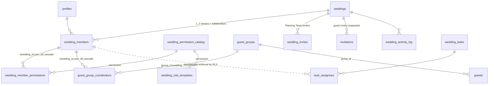

# Planning Team — 06. Proposed database architecture

Status: **proposal only.** No table, function, or migration has been created. SQL below is illustrative and will be finalised, reviewed, and tested in Milestone 2. `reference/kiburan_schema.sql` and the existing migrations are never edited; everything is an additive migration.

Design principles:

1. Extend existing tables (`wedding_members`, `wedding_invites`, `guest_groups`, `guests`) instead of creating parallel systems.
2. All authority checks in the database (`SECURITY DEFINER` RPCs with `search_path = ''`, RLS policies), never in the client.
3. Every new wedding-scoped table carries `wedding_id` and uses **composite foreign keys** so a row can only point at members/groups of the same wedding.
4. Every change is safe for existing weddings (each has exactly one `owner` row locally; production must be checked with the same assertion queries before applying).

---

## 1. How two equal owners will work

### Representation

Both spouses are rows in `wedding_members` with `role = 'owner'`. Nothing else marks one as "primary". `weddings.created_by` remains a historical field only and is made immutable (it is never used for authorization).

Why not use `partner`: `partner` already exists with write-but-no-admin semantics (doc 03). Re-defining it would silently change access for any existing `partner` rows in production. Using `owner` for both reuses every existing owner check (`is_wedding_owner`, invite creation, comment moderation) with no policy rewrites.

### Invariants (database-enforced)

| Invariant | Mechanism |
| --- | --- |
| At least 1 owner per wedding | Constraint trigger on `wedding_members` (INSERT/UPDATE/DELETE) that locks the parent `weddings` row `FOR UPDATE`, then counts owners |
| At most 2 owners per wedding | Same trigger |
| No direct client writes to `wedding_members` | Already true (no INSERT/UPDATE/DELETE policy); keep it |
| Owner rows can only change through ownership RPCs | Trigger rejects role changes to/from `owner` unless a transaction-local flag (`set_config('kiburan.ownership_rpc','on', true)`) is set by those RPCs |

Locking the `weddings` row serializes all owner changes for that wedding, fixing the current race in `set_wedding_member_role`.

Edge cases the trigger must handle: (a) when the wedding itself is being deleted (cascade), the "at least 1 owner" rule must not fire — the trigger skips the check if the parent `weddings` row no longer exists; (b) account deletion cascades `profiles → wedding_members`, so deleting the sole owner's account would be blocked. That is arguably correct (it would orphan the wedding) but must be part of the account-deletion decision already open in `docs/schema-audit.md` (Q3).

### Ownership operations

| Operation | Who | Rule |
| --- | --- | --- |
| Invite the second owner | Either owner when the wedding has exactly 1 owner | `create_team_invite(kind => 'co_owner')`. The invitee becomes owner only by accepting with their own account, which is the explicit confirmation. Only one pending co-owner invite at a time. |
| Accept co-owner invite | The invited account (email-bound) | Re-checks owner count under lock; fails if 2 owners already exist |
| Step down to collaborator / leave | An owner, for themselves | Only if another owner remains. Logged and visible to the other owner. |
| Remove or downgrade the **other** owner | Nobody unilaterally | Creates an `ownership_change_requests` row; takes effect only when the **affected owner** confirms. |
| Transfer ownership to a collaborator | Requires both owners to confirm (if two) | Request/confirm; collaborators can never self-promote |
| Promote a collaborator to owner via `set_wedding_member_role` | Nobody | The hardened RPC rejects `'owner'` as a target role and rejects owner targets |
| Deadlock: other owner unreachable / dispute | — | **Open decision D4.** There is no platform admin today. Recommendation: a support-only, service-role procedure run outside the app, with audit. Not implemented by the app. |

`ownership_change_requests` is designed now but implemented after the core milestones (it is not needed until two owners exist and one wants to change the set).

---

## 2. Proposed changes

Each item lists: why · existing table? · relationships · security · migration · preservation.

### 2.1 `wedding_members` extension

| | |
| --- | --- |
| Why | Need role templates (Co-host, Family coordinator, Task manager, Custom), attribution of who added a member, and change tracking. |
| Existing table? | Yes — extend it; it is already the source of truth for access. |
| Change | Replace `wedding_members_role_check` with a **superset**: `owner, partner, planner, collaborator, viewer, co_host, family_coordinator, task_manager, custom`. Add `invited_by uuid null references profiles`, `updated_at timestamptz default now()` with the existing `set_updated_at` trigger. Add `unique (wedding_id, user_id)` is already the PK (used as a composite-FK target). |
| Relationships | Target of composite FKs from permissions, coordinators, (later) task assignees. |
| Security | Still no client write policies. SELECT changes from "any member" to `team.view` or own row. Owner-count trigger (section 1). |
| Migration | Yes. Drop and re-create the check constraint with the superset (existing values remain valid; no row rewrite). |
| Preservation | All 155 local rows are `owner` and stay unchanged. Existing `partner/planner/collaborator/viewer` rows (if any in production) remain valid. |

Alternative considered: keep `role` as `owner/member` tier and add a separate `role_template` column. Rejected for now because it requires rewriting every existing row and every helper; the superset approach is additive. (Decision D1.)

### 2.2 `wedding_permission_catalog` (reference table)

| | |
| --- | --- |
| Why | A single list of valid permission keys, their category, dependencies, whether they are financial, and whether they are grantable to non-owners. Lets the database reject unknown or reserved keys. |
| Existing table? | No equivalent. |
| Shape | `key text PK`, `category text`, `description text`, `is_grantable boolean`, `is_financial boolean`, `requires text[]` |
| Security | RLS: SELECT for `authenticated`; no client writes. Seeded by migration only. |
| Migration | Yes (new table + seed rows). |
| Preservation | No impact on existing data. |

### 2.3 `wedding_role_templates` (reference table)

| | |
| --- | --- |
| Why | Default permission sets per template (doc 05), readable by the app for the role picker. |
| Existing table? | No. |
| Shape | `template text`, `permission text references wedding_permission_catalog(key)`, PK `(template, permission)` |
| Security | SELECT for `authenticated`; seeded by migration; never client-written. |
| Migration | Yes. |
| Preservation | None needed. |

### 2.4 `wedding_member_permissions`

| | |
| --- | --- |
| Why | Effective, owner-configurable permissions per collaborator. Rows (not a JSON array) because RLS needs fast indexed `exists` lookups and per-permission audit. |
| Existing table? | No. `wedding_members.role` alone cannot express custom access. |
| Shape | `wedding_id uuid`, `user_id uuid`, `permission text references wedding_permission_catalog(key)`, `granted_by uuid references profiles`, `granted_at timestamptz default now()`; PK `(wedding_id, user_id, permission)`; FK `(wedding_id, user_id) references wedding_members(wedding_id, user_id) on delete cascade`. |
| Relationships | Cascades away when the membership is removed, so revoking membership revokes every permission atomically. |
| Security | SELECT own rows, or owner. No client writes; changed only by `set_member_permissions` / `apply_role_template` RPCs (owner-only, validates keys are grantable, applies dependency closure, logs activity). A trigger rejects rows for owners (owners are implicit) and non-grantable keys. |
| Migration | Yes. |
| Preservation | **Backfill decision D9.** For existing non-owner members (0 locally, unknown in production), either (a) preserve current behaviour by granting the template equivalent of their legacy role, *including* budget access for `partner/planner/collaborator`, or (b) apply the new defaults (no budget). Recommendation: (a) for existing rows, flagged for owner review in the UI; (b) for all new invites. |

### 2.5 `guest_group_coordinators`

| | |
| --- | --- |
| Why | Group-based guest management (Bride's family, Groom's family, Friends, …) with isolation between groups. |
| Existing table? | No. `guest_groups.side` identifies bride/groom side but grants nothing. |
| Shape | `wedding_id uuid`, `group_id uuid`, `user_id uuid`, `can_delete boolean default false`, `can_send_invitations boolean default true`, `assigned_by uuid references profiles`, `assigned_at timestamptz default now()`; PK `(group_id, user_id)`; FK `(wedding_id, user_id) → wedding_members on delete cascade`; FK `(group_id, wedding_id) → guest_groups(id, wedding_id) on delete cascade`. |
| Requires | New `unique (id, wedding_id)` on `guest_groups` (additive; already implied by the PK) so the composite FK guarantees group and member are in the same wedding. Index on `(wedding_id, user_id)`. |
| Security | SELECT own rows, owner, or `guests.manage_all`. Written only by owner RPCs `assign_group_coordinator` / `unassign_group_coordinator`. |
| Migration | Yes. |
| Preservation | No existing rows affected; existing groups simply have no coordinators. |

Family groups: no new table is needed. "Bride's family" / "Groom's family" are `guest_groups` rows with `side = 'partner_one' / 'partner_two'`. Milestone 6 can offer a one-tap "create family groups" action that inserts them if missing (decision D10 on whether to auto-create).

### 2.6 `wedding_activity_log`

| | |
| --- | --- |
| Why | Owners must see all relevant changes; members see history for what they can access; required for accountability between collaborators. |
| Existing table? | No. |
| Shape | `id uuid PK`, `wedding_id uuid not null references weddings on delete cascade`, `actor_id uuid references profiles on delete set null`, `action text` (e.g. `guest.created`, `member.permissions_changed`), `entity_type text`, `entity_id uuid`, `required_permission text null references wedding_permission_catalog(key)`, `summary jsonb` (non-sensitive: names/labels, never contact data or amounts unless `required_permission` is financial), `created_at timestamptz default now()`. Index `(wedding_id, created_at desc)`. |
| Writes | Only from `AFTER` triggers on audited tables and from team RPCs, via a `private.log_activity(...)` definer function. No client INSERT/UPDATE/DELETE policy (append-only). |
| Security | SELECT: owner sees all; others need `activity.view` **and** `required_permission` (if set) — so a coordinator never sees budget events. |
| Migration | Yes. |
| Preservation | Starts empty; no historical backfill (decision D11 on retention). |

### 2.7 Guest attribution

| | |
| --- | --- |
| Why | "Guest attribution" and "owners see all relevant changes" (Milestone 6). |
| Existing table? | Extend `guests` (and `guest_groups`). |
| Change | `guests`: add `created_by uuid null references profiles on delete set null`, `updated_by uuid null …`, `updated_at timestamptz null`. A `BEFORE INSERT/UPDATE` trigger sets them from `auth.uid()` (client values ignored). Add index `guests (group_id)` for group-scoped RLS. `guest_groups`: add `created_by`. |
| Security | Columns are set only by trigger; RLS unchanged in shape. |
| Migration | Yes, additive nullable columns (no table rewrite on PG 15). |
| Preservation | Existing guests get `NULL` attribution, shown as "Added before team sharing". |

Optional (decision): the same `created_by/updated_by` on `budget_items` and `wedding_events`.

### 2.8 `wedding_invites` improvements

| | |
| --- | --- |
| Why | Fix F1–F4 and carry the intended access into acceptance. |
| Existing table? | Yes — keep `wedding_invites` (Planning Team) completely separate from `invitations` (guests). |
| Change | Add: `invite_kind text not null default 'collaborator' check (in ('collaborator','co_owner'))`; `invited_email_normalized text generated always as (lower(btrim(invited_email))) stored`; `permissions text[] not null default '{}'` (snapshot applied on accept); `group_assignments jsonb not null default '[]'` (`[{group_id, can_delete, can_send_invitations}]`); `revoked_by uuid references profiles`; `last_sent_at timestamptz`. Extend role check to the new template names. Add checks: `(accepted_by is null) = (accepted_at is null)`; `expires_at > created_at`. |
| Duplicates | Unique partial index on `(wedding_id, invited_email_normalized) where accepted_at is null and revoked_at is null`. Expired-but-unrevoked rows would block re-invites, so `create_team_invite` first marks expired pending rows `revoked_at = now()` for that address under a wedding lock. |
| Status | Derived, not stored: `pending / accepted / revoked / expired` computed in `list_team_invites` RPC. |
| Token secrecy | Revoke table-level SELECT/INSERT/UPDATE from `anon, authenticated`; grant SELECT only on non-hash columns to `authenticated`; drop the direct UPDATE policy (revocation becomes an RPC). Same treatment for `invitations.token_hash`, with `UPDATE (status)` re-granted so the existing cancel call keeps working until it moves to an RPC. |
| Migration | Yes. |
| Preservation | 0 invites locally. Existing rows (if any) default to `collaborator` kind, empty permissions; the role-template backfill applies on acceptance. |

### 2.9 Secure RPCs (all `SECURITY DEFINER`, `search_path = ''`, `revoke execute from public, anon`, grant to `authenticated`)

| RPC | Authorization | Atomic effects |
| --- | --- | --- |
| `get_my_wedding_access(wedding_id)` | member | Returns own role, permissions, coordinated groups |
| `list_team_members(wedding_id)` | `team.view` | Members + profile display names (no phone unless owner) |
| `create_team_invite(wedding_id, email, kind, role_template, permissions[], group_assignments, expires_in)` | owner | Validates keys/groups, bounds expiry (1 h–30 d), duplicate/member checks, returns raw token once, logs |
| `resend_team_invite(invite_id)` | owner | Rotates token hash, extends expiry, returns new raw token |
| `revoke_team_invite(invite_id)` | owner | Sets `revoked_at/by`, logs |
| `list_team_invites(wedding_id)` | owner | No hashes |
| `get_team_invite_preview(raw_token)` | authenticated (decision D12 on anon) | Wedding title, inviter name, role label, kind, expiry. No member/guest data. |
| `accept_team_invite(raw_token)` | authenticated, confirmed email = `invited_email` | Lock invite + wedding; reject used/revoked/expired; **reject if already a member** (no role change); insert membership, permissions, coordinator rows; set accepted; log |
| `set_member_role_template(wedding_id, user_id, template, reset_permissions bool)` | owner; target not owner | Replaces `set_wedding_member_role` for collaborators |
| `set_member_permissions(wedding_id, user_id, permissions[])` | owner; target not owner | Validates, dependency closure, diff logged |
| `assign_group_coordinator / unassign_group_coordinator` | owner | Same-wedding guaranteed by composite FKs |
| `remove_member(wedding_id, user_id)` | owner; target not owner | Deletes membership (cascades permissions/coordinators), removes their `task_assignees` in that wedding, nulls `timeline_items.assigned_to`, logs |
| `leave_wedding(wedding_id)` | self | Owner only if another owner remains |
| `get_budget_summary(wedding_id)` | `budget.view` | Category totals without line items |
| `request_ownership_change / respond_ownership_change` | owners | Two-party confirmation (later milestone) |

Existing functions:

- `accept_wedding_invite`: replaced with a body that delegates to `accept_team_invite` semantics (no role change on existing membership). Kept by name because generated types reference it; no client calls it.
- `create_wedding_invite`: kept as a thin wrapper or revoked from `authenticated` once `create_team_invite` exists (no client calls it).
- `set_wedding_member_role`: hardened to reject `owner` as target role or target member.
- `create_wedding`: unchanged (creator is the first owner).
- Guest RPCs: authorization switched from `can_write_wedding` to `guests.send_invitations` / group access.

### 2.10 Helper functions

`private.has_wedding_permission(wedding_id, key)`, `private.can_access_guest_group(wedding_id, group_id, capability)`, `private.log_activity(...)`. `private.can_write_wedding` is kept (storage policies and vendor policies still use it) but is no longer used for finance, guests, team, or settings.

### 2.11 Budget allocation vs expense

| | |
| --- | --- |
| Why | `budget.manage` (allocations) and `budget.expenses.*` must be separable, but both live in `budget_items` with no discriminator. |
| Change | Add `budget_items.item_kind text not null default 'expense' check (in ('allocation','expense'))`. Backfill: rows created by `create_wedding` onboarding (label = category name, no vendor, no payments, created in the same transaction as the wedding) become `allocation`. |
| Migration | Yes; backfill heuristic must be reviewed (decision D8). Alternative: treat every `budget_items` row as an expense and let `budget.manage` cover only `wedding_budgets.total_budget`. |

### 2.12 Hardening that the Planning Team depends on

| Item | Change |
| --- | --- |
| Weddings settings (F9) | Remove the direct UPDATE policy for non-owners; add `update_wedding_settings` RPC (owner) or owner-only UPDATE policy; trigger makes `created_by` immutable. Covers bucket write → owner. |
| Timeline assignee (F10) | Trigger: `assigned_to` must be a member of the event's wedding. |
| Vendor-side updates (F8) | Trigger freezing `wedding_id`/`created_by`; vendor team limited to status/quote columns. Separate ticket, recommended in the same release. |
| anon EXECUTE (F11) | `revoke execute … from anon` on all authenticated-only RPCs. |
| Test suite (F13) | Replace swallow-all exception blocks with exact SQLSTATE/message assertions. |

### 2.13 Not needed now

- No separate "workspace" table: `wedding_members` already models multi-wedding membership, and the URL `weddingId` is the workspace.
- No change to `task_assignees` shape (its INSERT policy already enforces membership); `remove_member` handles cleanup. Optional `assigned_by` column for attribution.
- No realtime publication until RLS is final.

---

## 3. Relationship overview

## 4. Migration plan (Milestone 2, proposed file order)

1. `…_team_hardening.sql` — token-hash privileges, anon EXECUTE revokes, `created_by` immutability, timeline assignee trigger, harden `set_wedding_member_role` and `accept_wedding_invite`.
2. `…_team_foundation.sql` — role superset, `wedding_members` columns, owner-count trigger (preceded by an assertion that every wedding has 1–2 owners), catalog, templates, permissions table, coordinator table, `guest_groups (id, wedding_id)` unique.
3. `…_team_activity_and_attribution.sql` — activity log, guest attribution columns/triggers, `budget_items.item_kind` (if approved).
4. `…_team_invites.sql` — `wedding_invites` columns/indexes and invite RPCs.
5. `…_team_rls.sql` — helper functions and per-table policy replacement (drop old policy, create new policy, in one transaction per table).
6. `supabase/tests/planning_team_security.sql` — new suite; existing suite fixed.

Each migration is applied only to the local stack (`npm run db:reset`), followed by types regeneration, the SQL suites, and the integration tests. Nothing is deployed without approval.
