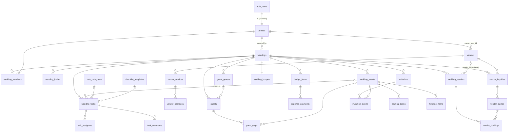

# Kiburan schema audit

| | |
| --- | --- |
| Source | `reference/kiburan_schema.sql` (PM-supplied, 383 lines) |
| Baseline SHA-256 | `B1D81E008878182E57580D96005D1C34FDA019ABF8F574BC85D772A049A2C594` |
| Target | PostgreSQL 15+ on Supabase |
| Status | Audit complete. Local security foundation migrations applied and validated on a clean local Supabase stack (`db reset` + `security_foundation` tests + generated types). Original SQL still unchanged. |

## How to read this document

- **Confirmed**: follows directly from the SQL text or from documented PostgreSQL semantics.
- **Assumption**: depends on product intent, on Supabase project settings, or on the UI reference. These are not defects until the PM confirms them.
- Proposed fixes (section 10) are labeled **Finding**, **Recommendation**, or **Open question**.

**Applied locally (additive migrations only, not edits to the PM file):** P0 items 1–6 with a **provisional** role matrix; P1 seating/cross-wedding trigger guards; P2 `updated_at` triggers + selected FK indexes. Still open: admin role (Q2), deletion policy (Q3), invite email/phone match (Q4), and all P3 product questions.

Object counts in the SQL: 37 tables, 76 foreign keys, 9 explicit `unique` constraints, 16 secondary indexes, 1 extension (`pgcrypto`). The file contains 0 `enable row level security`, `create policy`, `grant`, `create function`, or `create trigger` statements.

---

## 1. Table inventory

### Identity

| Table | Purpose | Key |
| --- | --- | --- |
| `profiles` | App profile for each Supabase auth user: display name, phone, avatar, language (`en`/`am`) | `id` = `auth.users.id` |

### Wedding core

| Table | Purpose | Key |
| --- | --- | --- |
| `weddings` | A wedding: partner names, date, city, timezone, style, status, currency, estimated guest count | `id` |
| `wedding_members` | Users who collaborate on a wedding, with role `owner`/`partner`/`planner`/`collaborator`/`viewer` | (`wedding_id`, `user_id`) |
| `wedding_invites` | Pending invitations for collaborators to join a wedding (by email or phone, using a hashed token) | `id` |
| `wedding_events` | Sub-events of a wedding (ceremony, reception, etc.) with time and venue | `id` |

### Checklist and tasks

| Table | Purpose | Key |
| --- | --- | --- |
| `task_categories` | Global, bilingual task categories (Venue, Catering, ...) | `id`, unique `slug` |
| `checklist_templates` | Global, bilingual task templates with suggested days before the wedding | `id` |
| `wedding_tasks` | Tasks for one wedding. Optional event, category, template, and parent task. Has status, priority, and due date | `id` |
| `task_assignees` | Many-to-many link between tasks and profiles | (`task_id`, `user_id`) |
| `task_comments` | Comments on a task | `id` |

### Vendor marketplace

| Table | Purpose | Key |
| --- | --- | --- |
| `vendor_categories` | Global, bilingual vendor categories | `id`, unique `slug` |
| `vendors` | Vendor business listing with verification and listing status | `id`, unique `slug` |
| `vendor_team_members` | Profiles that manage a vendor (`owner`/`manager`/`staff`) | (`vendor_id`, `user_id`) |
| `vendor_category_memberships` | Many-to-many link between vendors and categories | (`vendor_id`, `category_id`) |
| `vendor_services` | Services a vendor offers, with base price and price unit | `id` |
| `vendor_packages` | Priced packages within a service, with an `inclusions` JSON array | `id` |
| `vendor_media` | Images and videos for a vendor or a service (storage paths) | `id` |
| `vendor_availability` | Availability windows for a vendor or service | `id` |
| `vendor_reviews` | One review per (vendor, wedding), rated 1–5 and moderated | `id` |

### Wedding ↔ vendor workflow

| Table | Purpose | Key |
| --- | --- | --- |
| `wedding_vendors` | A vendor attached to a wedding. Can be a marketplace vendor or an external supplier (name/phone). Status runs from shortlisted to completed | `id` |
| `vendor_inquiries` | A wedding's inquiry to a marketplace vendor | `id` |
| `vendor_quotes` | A vendor's quote in reply to an inquiry | `id` |
| `vendor_bookings` | A confirmed booking for a `wedding_vendors` row, with amounts and a contract file | `id` |

### Budget

| Table | Purpose | Key |
| --- | --- | --- |
| `budget_categories` | Global, bilingual budget categories | `id`, unique `slug` |
| `wedding_budgets` | One total budget per wedding | `wedding_id` |
| `budget_items` | Line items with estimated and committed amounts. Optional link to a wedding vendor or booking | `id` |
| `expense_payments` | Payments against a budget item (`cash`, `bank_transfer`, `telebirr`, `chapa`, `card`, `other`) | `id` |

### Guests, invitations, RSVP, seating

| Table | Purpose | Key |
| --- | --- | --- |
| `guest_groups` | Households or groups of guests, with side | `id` |
| `guests` | Individual guests, with side, type, plus-one flag, and dietary notes | `id` |
| `invitation_designs` | Invitation design data (JSON) and a rendered file path | `id` |
| `invitations` | An invitation to a guest or a group, with delivery channel, status, and token hash | `id`, unique `token_hash` |
| `invitation_events` | Which events an invitation covers | (`invitation_id`, `event_id`) |
| `guest_rsvps` | A guest's response and check-in for each event | (`guest_id`, `event_id`) |
| `seating_tables` | Tables for an event, with capacity | `id`, unique (`event_id`, `name`) |
| `seating_assignments` | A guest's table and seat at an event | (`event_id`, `guest_id`) |

### Schedule and files

| Table | Purpose | Key |
| --- | --- | --- |
| `timeline_items` | Run-of-show items within an event, optionally assigned to a profile | `id` |
| `wedding_files` | Files uploaded to a wedding, optionally linked to a task or booking | `id` |

---

## 2. Relationships

Summary (Confirmed):

- **Profiles** are 1:1 with `auth.users`. Profiles are referenced as wedding creators, members, inviters/accepters, task creators/assignees/commenters, vendor owners/team, inquiry creators, payment recorders, timeline assignees, file uploaders, and reviewers.
- **Weddings** are the tenant root. Every wedding-scoped table reaches `weddings` either directly through `wedding_id` or indirectly through `wedding_events`, `wedding_tasks`, `wedding_vendors`, `budget_items`, `guests`, or `invitations`.
- **Wedding members** give users access to weddings. `weddings.created_by` is separate from membership; nothing requires the creator to also be a member.
- **Events** are children of a wedding. Tasks, wedding vendors, inquiries, invitations (via `invitation_events`), RSVPs, seating, and timeline items reference events.
- **Tasks** belong to a wedding. They can optionally reference an event, a global category, a global template, and a parent task.
- **Vendors** are global, not wedding-scoped. A wedding connects to them through `wedding_vendors` (and inquiries). Inquiry → quote → booking forms the commercial chain, and a booking hangs off `wedding_vendors`, not off the inquiry.
- **Budgets**: one `wedding_budgets` row per wedding, many `budget_items` per wedding, many `expense_payments` per item. Items can point at a wedding vendor and/or a booking.
- **Guests and invitations**: guests can belong to a group. An invitation targets a guest, a group, or both, and covers one or more events. RSVPs are per guest per event.

---

## 3. Constraints and indexes present

### 3.1 Foreign keys (76)

`NO ACTION` means no `on delete` clause, so PostgreSQL's default applies: deleting the referenced row fails while referencing rows exist.

| Table.column | References | On delete |
| --- | --- | --- |
| `profiles.id` | `auth.users.id` | cascade |
| `weddings.created_by` | `profiles` | NO ACTION |
| `wedding_members.wedding_id` | `weddings` | cascade |
| `wedding_members.user_id` | `profiles` | cascade |
| `wedding_invites.wedding_id` | `weddings` | cascade |
| `wedding_invites.invited_by` | `profiles` | NO ACTION |
| `wedding_invites.accepted_by` | `profiles` | NO ACTION |
| `wedding_events.wedding_id` | `weddings` | cascade |
| `checklist_templates.category_id` | `task_categories` | NO ACTION |
| `wedding_tasks.wedding_id` | `weddings` | cascade |
| `wedding_tasks.event_id` | `wedding_events` | set null |
| `wedding_tasks.category_id` | `task_categories` | set null |
| `wedding_tasks.template_id` | `checklist_templates` | set null |
| `wedding_tasks.parent_task_id` | `wedding_tasks` | set null |
| `wedding_tasks.created_by` | `profiles` | NO ACTION |
| `task_assignees.task_id` | `wedding_tasks` | cascade |
| `task_assignees.user_id` | `profiles` | cascade |
| `task_comments.task_id` | `wedding_tasks` | cascade |
| `task_comments.author_id` | `profiles` | NO ACTION |
| `vendors.owner_user_id` | `profiles` | NO ACTION |
| `vendor_team_members.vendor_id` | `vendors` | cascade |
| `vendor_team_members.user_id` | `profiles` | cascade |
| `vendor_category_memberships.vendor_id` | `vendors` | cascade |
| `vendor_category_memberships.category_id` | `vendor_categories` | cascade |
| `vendor_services.vendor_id` | `vendors` | cascade |
| `vendor_services.category_id` | `vendor_categories` | set null |
| `vendor_packages.service_id` | `vendor_services` | cascade |
| `vendor_media.vendor_id` | `vendors` | cascade |
| `vendor_media.service_id` | `vendor_services` | set null |
| `vendor_availability.vendor_id` | `vendors` | cascade |
| `vendor_availability.service_id` | `vendor_services` | cascade |
| `wedding_vendors.wedding_id` | `weddings` | cascade |
| `wedding_vendors.event_id` | `wedding_events` | set null |
| `wedding_vendors.vendor_id` | `vendors` | set null |
| `wedding_vendors.category_id` | `vendor_categories` | set null |
| `vendor_inquiries.wedding_id` | `weddings` | cascade |
| `vendor_inquiries.vendor_id` | `vendors` | NO ACTION |
| `vendor_inquiries.service_id` | `vendor_services` | NO ACTION |
| `vendor_inquiries.requested_event_id` | `wedding_events` | set null |
| `vendor_inquiries.created_by` | `profiles` | NO ACTION |
| `vendor_quotes.inquiry_id` | `vendor_inquiries` | cascade |
| `vendor_quotes.package_id` | `vendor_packages` | NO ACTION |
| `vendor_bookings.wedding_vendor_id` | `wedding_vendors` | cascade |
| `vendor_bookings.quote_id` | `vendor_quotes` | NO ACTION |
| `wedding_budgets.wedding_id` | `weddings` | cascade |
| `budget_items.wedding_id` | `weddings` | cascade |
| `budget_items.category_id` | `budget_categories` | set null |
| `budget_items.wedding_vendor_id` | `wedding_vendors` | set null |
| `budget_items.booking_id` | `vendor_bookings` | set null |
| `expense_payments.budget_item_id` | `budget_items` | cascade |
| `expense_payments.recorded_by` | `profiles` | NO ACTION |
| `guest_groups.wedding_id` | `weddings` | cascade |
| `guests.wedding_id` | `weddings` | cascade |
| `guests.group_id` | `guest_groups` | set null |
| `invitation_designs.wedding_id` | `weddings` | cascade |
| `invitations.wedding_id` | `weddings` | cascade |
| `invitations.group_id` | `guest_groups` | set null |
| `invitations.guest_id` | `guests` | set null |
| `invitations.design_id` | `invitation_designs` | set null |
| `invitation_events.invitation_id` | `invitations` | cascade |
| `invitation_events.event_id` | `wedding_events` | cascade |
| `guest_rsvps.guest_id` | `guests` | cascade |
| `guest_rsvps.event_id` | `wedding_events` | cascade |
| `seating_tables.event_id` | `wedding_events` | cascade |
| `seating_assignments.event_id` | `wedding_events` | cascade |
| `seating_assignments.guest_id` | `guests` | cascade |
| `seating_assignments.table_id` | `seating_tables` | cascade |
| `timeline_items.event_id` | `wedding_events` | cascade |
| `timeline_items.assigned_to` | `profiles` | NO ACTION |
| `wedding_files.wedding_id` | `weddings` | cascade |
| `wedding_files.uploaded_by` | `profiles` | NO ACTION |
| `wedding_files.task_id` | `wedding_tasks` | set null |
| `wedding_files.booking_id` | `vendor_bookings` | set null |
| `vendor_reviews.vendor_id` | `vendors` | cascade |
| `vendor_reviews.wedding_id` | `weddings` | cascade |
| `vendor_reviews.reviewer_id` | `profiles` | NO ACTION |

### 3.2 Primary keys and unique constraints

- Surrogate `uuid` primary keys (`gen_random_uuid()`) on all entity tables. `profiles.id` has no default; it must be supplied from `auth.users`.
- Composite primary keys: `wedding_members (wedding_id, user_id)`, `task_assignees (task_id, user_id)`, `vendor_team_members (vendor_id, user_id)`, `vendor_category_memberships (vendor_id, category_id)`, `invitation_events (invitation_id, event_id)`, `guest_rsvps (guest_id, event_id)`, `seating_assignments (event_id, guest_id)`. `wedding_budgets` uses `wedding_id` as its PK, which enforces one budget per wedding.
- Explicit unique constraints (9):
  - `wedding_invites.token_hash`
  - `task_categories.slug`
  - `vendor_categories.slug`
  - `vendors.slug`
  - `budget_categories.slug`
  - `invitations.token_hash`
  - `seating_tables (event_id, name)`
  - `seating_assignments (table_id, seat_number)`. `seat_number` is nullable, so any number of unnumbered guests can share a table.
  - `vendor_reviews (vendor_id, wedding_id)`

### 3.3 Check constraints

| Table | Check |
| --- | --- |
| `profiles` | `preferred_language in ('en','am')` |
| `weddings` | `status in ('planning','completed','cancelled','archived')`; `estimated_guest_count >= 0` |
| `wedding_members` | `role in ('owner','partner','planner','collaborator','viewer')` |
| `wedding_invites` | `role in ('partner','planner','collaborator','viewer')` (cannot invite an owner); `invited_email is not null or invited_phone is not null` |
| `wedding_events` | `ends_at >= starts_at` when both present |
| `wedding_tasks` | `status in ('todo','in_progress','blocked','done','cancelled')`; `priority in ('low','medium','high','urgent')` |
| `vendors` | `verification_status in ('unverified','pending','verified','rejected')`; `listing_status in ('draft','published','suspended')` |
| `vendor_team_members` | `role in ('owner','manager','staff')` |
| `vendor_services` | `base_price >= 0`; `price_unit in ('package','hour','day','person','item','custom')` |
| `vendor_packages` | `price >= 0` |
| `vendor_media` | `media_type in ('image','video')` |
| `vendor_availability` | `status in ('available','unavailable','tentative','booked')`; `ends_at > starts_at` |
| `wedding_vendors` | `status in ('shortlisted','contacted','negotiating','booked','completed','cancelled')`; `vendor_id is not null or external_business_name is not null` |
| `vendor_inquiries` | `proposed_budget >= 0`; `status in ('new','replied','quoted','accepted','declined','closed')` |
| `vendor_quotes` | `amount >= 0`; `status in ('draft','sent','accepted','rejected','expired')` |
| `vendor_bookings` | `total_amount >= 0`; `deposit_amount >= 0`; `status in ('pending','confirmed','fulfilled','cancelled')`; `end_at >= start_at`; `deposit_amount <= total_amount` |
| `wedding_budgets` | `total_budget >= 0` |
| `budget_items` | `estimated_amount >= 0`; `committed_amount >= 0` |
| `expense_payments` | `amount > 0`; `payment_method in ('cash','bank_transfer','telebirr','chapa','card','other')` |
| `guest_groups` | `side in ('partner_one','partner_two','both','other')` |
| `guests` | `side in (same as groups)`; `guest_type in ('family','friend','coworker','other')` |
| `invitations` | `delivery_channel in ('link','sms','whatsapp','email','print','other')`; `status in ('draft','ready','sent','delivered','opened','cancelled')`; `guest_id is not null or group_id is not null` |
| `guest_rsvps` | `response in ('pending','yes','no','maybe')` |
| `seating_tables` | `capacity > 0` |
| `seating_assignments` | `seat_number > 0` |
| `timeline_items` | `ends_at >= starts_at` when both present |
| `vendor_reviews` | `rating between 1 and 5`; `status in ('pending','published','hidden')` |

Columns with no check constraint (Confirmed): `wedding_events.event_type` (free text, default `'other'`), `weddings.style`, `country_code`, `currency_code`, and `timezone` (no format or allow-list checks), plus `vendor_packages.inclusions` (any JSON, not enforced to be an array).

### 3.4 Secondary indexes (16)

| Index | Columns |
| --- | --- |
| `idx_wedding_members_user` | `wedding_members (user_id)` |
| `idx_wedding_events_wedding` | `wedding_events (wedding_id, starts_at)` |
| `idx_wedding_tasks_board` | `wedding_tasks (wedding_id, status, due_date)` |
| `idx_wedding_tasks_category` | `wedding_tasks (wedding_id, category_id)` |
| `idx_task_assignees_user` | `task_assignees (user_id)` |
| `idx_vendor_search` | `vendors (city, listing_status, verification_status)` |
| `idx_vendor_services_vendor` | `vendor_services (vendor_id)` |
| `idx_vendor_availability` | `vendor_availability (vendor_id, starts_at, ends_at)` |
| `idx_wedding_vendors_wedding` | `wedding_vendors (wedding_id, status)` |
| `idx_vendor_inquiries_vendor` | `vendor_inquiries (vendor_id, status)` |
| `idx_budget_items_wedding` | `budget_items (wedding_id)` |
| `idx_expense_payments_item` | `expense_payments (budget_item_id)` |
| `idx_guests_wedding` | `guests (wedding_id, full_name)` |
| `idx_invitations_wedding_status` | `invitations (wedding_id, status)` |
| `idx_guest_rsvps_event` | `guest_rsvps (event_id, response)` |
| `idx_timeline_items_event` | `timeline_items (event_id, starts_at)` |

Primary keys and unique constraints also create indexes. Foreign-key columns with no index on them as the leading column include the following (Confirmed; the list is not exhaustive for rarely joined columns). They matter for cascading deletes and for the membership lookups RLS policies will do: `wedding_invites.wedding_id`, `task_comments.task_id`, `vendor_team_members.user_id`, `vendor_category_memberships.category_id`, `vendor_packages.service_id`, `vendor_media.vendor_id`, `vendor_inquiries.wedding_id`, `vendor_quotes.inquiry_id`, `vendor_bookings.wedding_vendor_id`, `guest_groups.wedding_id`, `guests.group_id`, `invitation_designs.wedding_id`, `invitation_events.event_id`, `seating_assignments.guest_id`, `wedding_files.wedding_id`, `vendor_reviews.wedding_id`, `vendors.owner_user_id`, `weddings.created_by`, `wedding_tasks.event_id`, and `wedding_tasks.parent_task_id`. (`seating_tables.event_id` is covered by its `unique (event_id, name)` constraint.)

---

## 4. RLS policies and grants requiring review

**Confirmed:**

- No table enables row level security, and the file has no policies and no grants.
- The schema's closing comment (lines 373–383) says itself that RLS and policies are still to be written.

**Assumption (Supabase platform behavior; verify on the target project):** Supabase normally grants `anon` and `authenticated` table privileges on `public` through default privileges. If so, then without RLS every table, including token hashes, guest phone numbers, and payments, would be readable and writable through the Data API by anyone holding the anon key. Treat this as a release blocker either way.

Access groups the policies will need to cover:

| Data | Who should access (assumption until PM confirms) |
| --- | --- |
| Wedding-scoped tables (events, tasks, guests, invitations, budget, seating, timeline, files, wedding vendors, inquiries) | Members of that wedding. Writes limited by role (`viewer` read-only?) |
| `wedding_members`, `wedding_invites` | Read by members. Writes by owners (and partners?) only |
| `vendors` and vendor children | Public read when `listing_status = 'published'`. Write by vendor team (role-dependent) |
| `vendor_inquiries`, `vendor_quotes` | The wedding's members **and** the vendor's team |
| `vendor_bookings` | The wedding's members and the vendor's team (booking links to vendor only via `wedding_vendors.vendor_id`) |
| `vendor_reviews` | Public read when `published`. Insert by eligible wedding member. Moderation by an admin role that doesn't exist in the schema yet |
| Lookup tables (`task_categories`, `checklist_templates`, `vendor_categories`, `budget_categories`) | Public or authenticated read, admin write |
| `profiles` | Self read/write. Limited read of co-members' and vendor contacts' names/avatars |
| Token-hash columns | Never selectable by clients. Accessed only through RPCs |

There is no admin or moderator concept anywhere in the schema (Confirmed). Vendor verification, review moderation, and lookup-table maintenance all need one.

Supabase Storage buckets and storage policies are also not defined. The schema stores files as paths in `avatar_url`, `cover_image_url`, `logo_url`, `cover_url`, `vendor_media.storage_path`, `contract_storage_path`, `receipt_storage_path`, `invitation_designs.storage_path`, and `wedding_files.storage_path` (Confirmed).

---

## 5. Cross-wedding reference integrity

**Confirmed:** every foreign key below points at the parent table's `id` only. Nothing in the SQL checks that both rows belong to the same wedding, event, or vendor. RLS alone does not prevent these mismatches, because a user who belongs to two weddings can legitimately see both sides.

| Child reference | Invariant not enforced |
| --- | --- |
| `wedding_tasks.event_id` | Event belongs to the task's wedding |
| `wedding_tasks.parent_task_id` | Parent task belongs to the same wedding. No cycle prevention either |
| `task_assignees.user_id` | Assignee is a member of the task's wedding |
| `wedding_vendors.event_id` | Event belongs to the same wedding |
| `vendor_inquiries.requested_event_id` | Event belongs to the inquiry's wedding |
| `vendor_inquiries.service_id` | Service belongs to `vendor_inquiries.vendor_id` |
| `vendor_quotes.package_id` | Package belongs to a service of the inquiry's vendor |
| `vendor_bookings.quote_id` | Quote's inquiry has the same wedding and vendor as `wedding_vendor_id` |
| `budget_items.wedding_vendor_id`, `booking_id` | Both belong to the item's wedding. Booking belongs to that wedding vendor |
| `guests.group_id` | Group belongs to the guest's wedding |
| `invitations.guest_id`, `group_id`, `design_id` | All belong to the invitation's wedding. If both guest and group are set, the guest is in that group |
| `invitation_events.event_id` | Event belongs to the invitation's wedding |
| `guest_rsvps (guest_id, event_id)` | Guest and event belong to the same wedding. Possibly also that the guest was invited to that event (open question) |
| `seating_assignments.table_id` vs `event_id` | **The table belongs to the same event as the assignment.** The SQL allows assigning a guest at event A to a table of event B |
| `seating_assignments.guest_id` | Guest belongs to the event's wedding |
| `timeline_items.assigned_to` | Assignee is a member of the event's wedding |
| `wedding_files.task_id`, `booking_id` | Both belong to the file's wedding |
| `vendor_media.service_id`, `vendor_availability.service_id` | Service belongs to the same vendor |
| `vendor_reviews.wedding_id` / `reviewer_id` | Reviewer is a member of that wedding. The wedding actually engaged the vendor |

Related constraint conflicts (Confirmed by PostgreSQL semantics, where `SET NULL` happens before the row's `CHECK` is evaluated):

- Deleting a `vendors` row sets `wedding_vendors.vendor_id` to null. For any row without an `external_business_name`, that violates `check (vendor_id is not null or external_business_name is not null)`, so **the vendor delete fails**.
- Deleting a `guests` row sets `invitations.guest_id` to null. For an invitation with no `group_id`, that violates the guest-or-group check, so **the guest delete fails**. The same applies when deleting a `guest_groups` row referenced by a group-only invitation.
- `NO ACTION` references to `profiles` (`weddings.created_by`, `task_comments.author_id`, `vendors.owner_user_id`, `expense_payments.recorded_by`, `wedding_files.uploaded_by`, `vendor_reviews.reviewer_id`, and others) mean that deleting an `auth.users` row, which cascades to `profiles`, **fails** for any user who created or authored such rows. This affects account deletion.
- `vendor_inquiries.vendor_id` is `NO ACTION`, so a vendor with inquiries cannot be deleted. That may be intended (soft-delete through `listing_status = 'suspended'`).

---

## 6. Authentication profile provisioning

**Confirmed:** `profiles.id` must equal an `auth.users.id`, has no default, and there is no trigger or function creating it. `display_name` defaults to `''`. `preferred_language` defaults to `'en'`.

**Requirements:**

1. Every new auth user needs a `profiles` row before any other insert, because nearly every table references `profiles`. The usual approach is an `after insert on auth.users` trigger, run as a `security definer` function with a locked `search_path`. The alternative is a client "complete profile" RPC. Either way, profile creation must be idempotent.
2. Decide the signup channel: email, phone/SMS OTP (common in Ethiopia), or both. `profiles.phone` is not unique and is not linked to `auth.users.phone`. Does the profile copy or mirror it?
3. Initial `display_name` and `preferred_language` should come from signup metadata (`raw_user_meta_data`) when present.
4. Clients must not be able to change `profiles.id` or set another user's profile.
5. Account deletion is blocked by the `NO ACTION` FKs listed in section 5. The PM needs to decide on a deletion and anonymization policy.

---

## 7. Transaction requirements

The schema's closing comment explicitly asks for security-definer RPCs for these two flows (Confirmed).

### 7.1 Create wedding

One transaction, inside a single RPC:

1. Insert `weddings` with `created_by = auth.uid()` (never taken from the client).
2. Insert `wedding_members (wedding_id, auth.uid(), 'owner')`. Without this, the creator cannot pass membership-based RLS and the wedding becomes orphaned.
3. Optionally insert `wedding_budgets` (one row per wedding). The UI shows a total budget.
4. Optionally create default `wedding_events` (the UI's countdown and schedule assume a main event).
5. Optionally copy active `checklist_templates` into `wedding_tasks`, computing `due_date` from `wedding_date - suggested_days_before`. The UI's "6 of 20 completed" implies seeded tasks (Assumption).

Without the RPC, a client inserting `weddings` and then `wedding_members` as two separate calls can fail halfway. RLS also creates a chicken-and-egg problem: the creator isn't a member yet, so membership-based policies would block step 2.

### 7.2 Accept wedding invite

Also one RPC, with the raw token passed in and hashed on the server:

1. Look up `wedding_invites` by `token_hash`, locking the row (`for update`).
2. Reject if `revoked_at` is not null, `accepted_at` is not null, or `expires_at <= now()`.
3. Optionally require the caller's verified email or phone to match `invited_email` / `invited_phone` (open question).
4. Insert `wedding_members` with the invite's `role`. Decide the behavior if the user is already a member: no-op, or upgrade/downgrade the role.
5. Set `accepted_by = auth.uid()` and `accepted_at = now()`.

Not enforced by the SQL (Confirmed): `accepted_by` and `accepted_at` are not required to be set together, `expires_at` is not required to be after `created_at`, and nothing stops duplicate pending invites for the same email or phone on the same wedding.

### 7.3 Other multi-step writes (Assumption)

- Booking a vendor: accept quote → create `vendor_bookings` → set `wedding_vendors.status = 'booked'` → create or update a `budget_items` row.
- Guest invitations: create `invitations` together with their `invitation_events` and, for each covered event, seed `guest_rsvps` as `pending`.
- Public RSVP by invitation token: anonymous, so it must be an RPC and never direct table access.

---

## 8. Update-timestamp automation

**Confirmed:** five tables have an `updated_at` column with `default now()`: `profiles`, `weddings`, `wedding_tasks`, `vendors`, `wedding_budgets`. There is no trigger, so the value is set on insert and **never changes on update** unless every client remembers to set it.

**Recommendation:** add a shared `set_updated_at()` trigger function and attach a `before update` trigger to those five tables.

**Open question:** these frequently-edited tables have no `updated_at` (several have no `created_at` either): `wedding_events`, `guests`, `guest_groups`, `budget_items`, `vendor_services`, `vendor_packages`, `vendor_inquiries`, `vendor_quotes`, `vendor_bookings`, `invitations`, `seating_assignments`, `timeline_items`, `vendor_reviews`. Sync, offline caching, and "last edited" UI would benefit from adding them. That would be a schema addition and needs PM approval.

Related (Confirmed): `wedding_tasks.completed_at` is not tied to `status = 'done'`. A trigger or RPC should set or clear it.

---

## 9. Questions for the product manager

1. **Roles and permissions.** What exactly can `partner`, `planner`, `collaborator`, and `viewer` do? Can a wedding have more than one `owner`, or none? (The schema allows both.) Can owners transfer ownership?
2. **Admin role.** Who verifies vendors, moderates reviews, and maintains lookup categories? Should there be an admin table, or use a Supabase custom claim?
3. **Deletion policy.** Should deleting an account or vendor be hard or soft? Right now several deletes fail outright (section 5).
4. **Invite acceptance.** Must the accepting user's email or phone match the invite?
5. **Guest headcount.** The UI shows "Total Guests: 3" on a single guest and a count per guest row. The schema has only `plus_one_allowed boolean`. Is the headcount a per-guest number, per invitation, or derived from group members?
6. **Guest tags.** The UI shows free-form tags (Family, Groom's Side, Bride's Side). The schema has `side` and `guest_type` enums only. Are those enough?
7. **Guest status.** "Invited / Confirmed / Not Invited" in the UI. Should this be derived from `invitations` + `guest_rsvps`, and for which event when there are several?
8. **Seating in the UI.** The UI shows one "Table Assignment" per guest. The schema assigns seating per event. Which event does the guest screen show?
9. **Saved vendors.** The UI has a heart/favorite and "3 saved". Should that map to `wedding_vendors.status = 'shortlisted'`, or is a separate favorites table wanted?
10. **Wedding style.** The UI offers Traditional / Modern / Blend. Should `weddings.style` be limited to these values?
11. **Partner labels.** The UI says "Bride's Name / Groom's Name". The schema uses neutral `partner_one_name` / `partner_two_name`. Confirm the UI labels are display-only (no rename).
12. **Countdown precision.** The dashboard counts down days, hours, and minutes. `weddings.wedding_date` is a `date`. Should the countdown use the earliest `wedding_events.starts_at`?
13. **Currency.** The UI mockup shows `$`, while defaults are `ETB`. `wedding_budgets.currency_code` can differ from `weddings.currency_code`, and `budget_items` / `expense_payments` have no currency column. Is one currency per wedding the rule?
14. **Event types.** `wedding_events.event_type` is free text. Is there a fixed list (e.g. engagement, melse, ceremony, reception)?
15. **RSVP scope.** Should RSVPs only be possible for events on the guest's invitation?
16. **Vendor availability.** Should overlapping availability windows be prevented, and should a confirmed booking automatically mark the window `booked`?
17. **Missing timestamps.** Approve adding `created_at` / `updated_at` to the tables listed in section 8?
18. **Seating capacity.** Should `seating_tables.capacity` be enforced when assigning guests?
19. **Budget totals.** Should payments be prevented from exceeding `committed_amount`, and budget items from exceeding `total_budget`? (Currently neither is enforced.)

---

## 10. Prioritized proposed fixes

None of these have been applied. Every schema change will be written as a separate migration, layered on top of the untouched PM file, and only after approval.

### P0: Must resolve before any client connects to Supabase

| # | Type | Item |
| --- | --- | --- |
| 1 | Finding | No RLS, policies, or grants exist on any of the 37 tables (section 4). |
| 2 | Recommendation | Enable RLS on every `public` table and write membership-, vendor-team-, and published-listing-based policies. Revoke direct client access to `token_hash` columns. |
| 3 | Finding | No profile provisioning exists, yet nearly every table depends on `profiles` (section 6). |
| 4 | Recommendation | Add a security-definer `handle_new_user` trigger on `auth.users`, with a locked `search_path`. |
| 5 | Finding | Wedding creation needs an atomic wedding + owner-member insert, which plain table inserts can't provide under RLS (section 7.1). |
| 6 | Recommendation | Add a `create_wedding` RPC and an `accept_wedding_invite` RPC (section 7.2). |
| 7 | Open question | Role capability matrix and admin role (questions 1–2). Policies can't be written without these answers. |

### P1: Data integrity

| # | Type | Item |
| --- | --- | --- |
| 8 | Finding | `seating_assignments.table_id` can point to a table from a different event than `seating_assignments.event_id`. |
| 9 | Finding | Many references can cross weddings or vendors (section 5 table). |
| 10 | Recommendation | Enforce same-wedding invariants, either with triggers or with composite foreign keys (adding `unique (id, wedding_id)` to parents and carrying `wedding_id` on children). Composite FKs need new columns, so this needs PM sign-off. |
| 11 | Finding | Deleting a vendor or a guest can fail because `ON DELETE SET NULL` conflicts with the either-or `CHECK` constraints on `wedding_vendors` and `invitations`. |
| 12 | Finding | Deleting an auth user fails if they authored rows that reference `profiles` with `NO ACTION`. |
| 13 | Open question | Hard vs. soft delete policy for accounts, vendors, and guests (question 3). That decides how to resolve items 11–12. |

### P2: Correctness and operability

| # | Type | Item |
| --- | --- | --- |
| 14 | Finding | `updated_at` exists on 5 tables but is never updated automatically. |
| 15 | Recommendation | Add a shared `set_updated_at` trigger on those tables. |
| 16 | Open question | Add `created_at` / `updated_at` to the frequently edited tables listed in section 8. |
| 17 | Finding | `wedding_tasks.completed_at` is not tied to `status`. |
| 18 | Finding | `wedding_invites` allows `accepted_by` without `accepted_at` (and vice versa), and duplicate pending invites. |
| 19 | Recommendation | Add indexes on the unindexed foreign keys listed in section 3.4, prioritizing the ones RLS policies will join on. |
| 20 | Recommendation | Define Storage buckets and storage policies to match the `*_storage_path` / `*_url` columns. |

### P3: Product alignment with the UI reference

| # | Type | Item |
| --- | --- | --- |
| 21 | Open question | Guest headcount, tags, status, and per-guest table display (questions 5–8). |
| 22 | Open question | Saved vendors (question 9). |
| 23 | Open question | Allowed values for `weddings.style` and `wedding_events.event_type` (questions 10, 14). |
| 24 | Open question | Currency consistency (question 13). |
| 25 | Recommendation | Leave table and column names unchanged. Map UI labels (e.g. "Bride/Groom") to `partner_one` / `partner_two` in the app layer only. |
| 26 | Open question | Overlap prevention for `vendor_availability`, seating capacity, and budget overspend rules (questions 16, 18, 19). |
